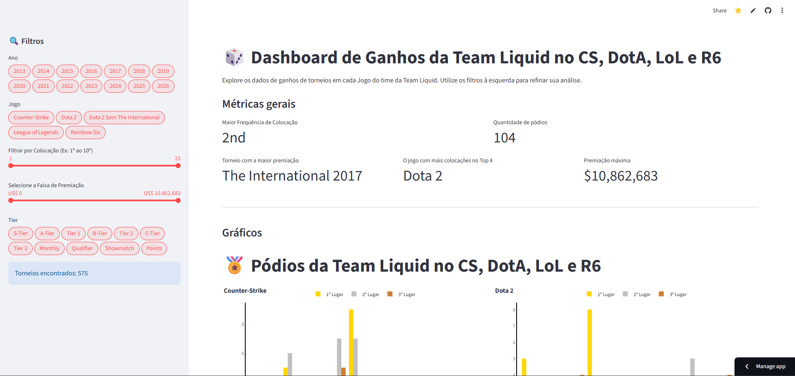
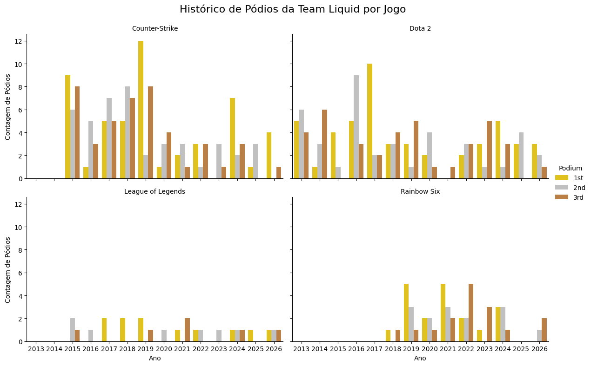
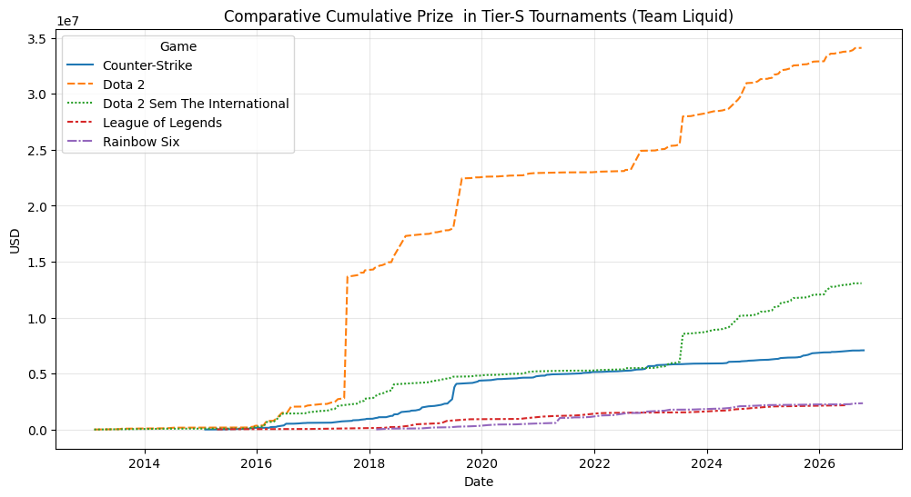

<div align="center">

# Análise de Performance e Ganhos em E-sports: Team Liquid


### [Acesse a Aplicação Online no Streamlit](https://seu-link-aqui.streamlit.app/)

<p align="center">
  
</p>

*Dashboard interativo consumindo dados da Liquipedia.*

</div>

---

## Visão Geral do Projeto

Este projeto tem como objetivo aplicar técnicas de **ingestão de dados via API**, **limpeza de dados com expressões regulares (Regex)**, **análise de séries temporais** e **visualização interativa** para responder perguntas analíticas essenciais do cenário competitivo:
- Como se comportam os ganhos acumulados de premiação ao longo dos anos entre as divisões de jogos?
- O volume financeiro reflete diretamente a consistência de pódios da organização?
- Qual o impacto de eventos com premiações astronômicas (*The International* no Dota 2) na distorção de comparações entre modalidades?
- Qual a distribuição anual de colocações de elite (1º, 2º e 3º lugares) em cada título?

---

## Pipeline de Ingestão: Liquipedia API & Conformidade

Diferente de rotinas convencionais de *scraping* que enfrentam restrições rigorosas de firewall e anti-bot (HTTP 403 Forbidden / Cloudflare), este projeto utiliza a **MediaWiki Action API oficial da Liquipedia**:
- **Conformidade com os Termos de Uso:** As requisições são identificadas por um `User-Agent` personalizado com e-mail de contato e compressão `gzip` ativa.
- **Segurança de Credenciais:** O e-mail de contato do desenvolvedor é isolado via variáveis de ambiente com `python-dotenv` (arquivo `.env`), mantendo o repositório seguro e em conformidade para versionamento no GitHub.
- **Rate Limiting:** Implementação de atrasos controlados (`time.sleep`) entre as chamadas para não sobrecarregar os servidores da wiki.
- **Tratamento de Hiperlinks:** O parsing do HTML extrai os links relativos das tags `<a>`, convertendo-os em links canônicos para cada torneio analisado.

---

## Tecnologias e Bibliotecas

- **Python 3.10+**
- [**Streamlit**](https://streamlit.io/): Desenvolvimento do dashboard analítico interativo e dinâmico.
- [**Requests**](https://requests.readthedocs.io/): Ingestão de dados automatizada via Liquipedia MediaWiki API.
- [**Pandas**](https://pandas.pydata.org/): Parsing de tabelas HTML (via `StringIO`), estruturação em DataFrames, manipulação e agregações temporais.
- [**Python-Dotenv**](https://pypi.org/project/python-dotenv/): Gerenciamento seguro de variáveis de ambiente.
- [**Plotly Express & Graph Objects**](https://plotly.com/python/): Gráficos dinâmicos, séries temporais e visualizações em grid.
- [**Seaborn** & **Matplotlib**](https://matplotlib.org/): Análises exploratórias visuais estáticas.
- [**Regex (re)**](https://docs.python.org/3/library/re.html): Higienização monetária, extração de posições com *lookbehinds* e normalização de strings.

---

## Dicionário de Dados

A base consolidada (`liquid_data.csv`) contém as seguintes variáveis processadas:

| Campo | Descrição |
| :--- | :--- |
| `Date` | Data de conclusão do torneio ou partida (`datetime64`) |
| `Game` | Título competitivo avaliado (Dota 2, CS, LoL, Rainbow Six) |
| `Tournament` | Nome oficial da competição |
| `Tournament_Link` | URL completa para a página do torneio no portal Liquipedia |
| `Tier` | Categoria de relevância do torneio (ex: S-Tier, Tier 1, A-Tier) |
| `Place` | Classificação textual final registrada (ex: `1st`, `2nd`, `3rd-4th`) |
| `Place_Int` | Posição numérica inteira extraída para filtros quantitativos |
| `Result` | Placar final ou resultado da série |
| `Prize_Clean` | Premiação monetária final em dólares (USD) convertida em valor numérico |
| `Cumulative_Prize` | Soma acumulada dos prêmios ao longo do tempo por título |

---

## Análises e Resultados

### 1. Distorção Financeira vs. Consistência Competitiva
- **Assimetria no Dota 2:** Historicamente, o Dota 2 concentra a maior fatia das premiações da Team Liquid. No entanto, essa métrica é massivamente influenciada por edições de *The International*, cujos prêmios milionários geram saltos exponenciais na curva de arrecadação.
- **Tratamento de Anomalia (*Dota 2 Sem The International*):** Ao remover isoladamente as edições do TI, a inclinação da curva do Dota 2 aproxima-se dos demais jogos, revelando que a rentabilidade contínua da org depende de um calendário com volumetria constante de torneios.
- **Diferenças Estruturais de Ecossistema:** Diferente do Counter-Strike e Dota 2 (circuitos abertos com premiações diretas constantes), jogos como **League of Legends** e **Rainbow Six** possuem grande parte de sua economia baseada em ligas franqueadas, o que se reflete em valores nominais de premiação menores no histórico geral.

---

### 2. Normalização de Desempenho por Pódios

Para contornar as disparidades financeiras entre ecossistemas de jogos distintos, foi implementada uma normalização de performance competitiva focada apenas em colocações de elite (**1º, 2º e 3º lugares**) via Regex com *lookbehind* negativo:

$\text{Padrão Regex} = \text{r'(?<!\d)(1st|2nd|3rd)'}$

<p align="center">
  
</p>

#### Resumo da Análise de Pódios:
- **Consistência do Counter-Strike:** Apesar de registrar premiações máximas unitárias inferiores às do Dota 2, a divisão de CS lidera em frequência de aparições em finais e semifinais, apresentando anos de dominância contínua (ex: a era do *Intel Grand Slam*).
- **Equilíbrio Competitivo:** Títulos como **Rainbow Six** demonstram uma proporção saudável de primeiros e segundos lugares a partir de sua consolidação competitiva na organização, provando que o sucesso esportivo independe do teto da premiação.

---

### 3. Evolução dos Ganhos Acumulados

Comparativo temporal da premiação acumulada (em USD) computada jogo a jogo:

<p align="center">
  
</p>

#### Resumo da Análise Financeira:
- **Pontos de Inflexão:** As grandes inflexões de receita ocorrem principalmente após vitórias em Majors de CS e edições históricas de campeonatos mundiais.
- **Volume Contínuo vs. Eventos Únicos:** O gráfico evidencia dois perfis distintos na organização: divisões que geram receita constante através de alta frequência de eventos ao longo do ano contra divisões de tiro curto, onde a maior parte do caixa é disputada em uma única janela anual.

---

### 4. Dashboard Interativo no Streamlit

O projeto conta com um painel dinâmico desenvolvido em Streamlit com componentes visuais em Plotly:

<p align="center">
  
</p>

- **Filtros Laterais Inteligentes:** Seleção multi-ano, segmentação por jogos (`st.pills`), limites de colocação (`st.slider`), faixas customizadas de premiação e agrupamento por Tiers do circuito competitivo.
- **Cards de KPIs:** Identificação dinâmica do torneio com maior premiação, valor máximo recebido, média modal de classificação e jogo com mais chegadas ao Top 4.
- **Tabela com Hiperlinks:** Listagem detalhada construída com `st.column_config.LinkColumn`, permitindo clicar no nome de qualquer torneio e acessar diretamente a documentação na Liquipedia.

---

## Estrutura do Repositório

```text
TeamLiquid-Analysis/
├── imagens/
│   ├── podios_por_jogo.png
│   ├── ganhos_acumulados.png
│   └── dashboard_streamlit.png
├── .env
├── .gitignore
├── app.py
├── team_liquid_analysis.ipynb
├── liquid_data.csv
├── requirements.txt
└── README.md
```

---

## Como Executar o Projeto

### 1. Clonar o repositório
```bash
git clone https://github.com/AlbertButzke/BrincadeiraComDados.git
cd BrincadeiraComDados/CounterStrike
```

### 2. Criar e ativar o ambiente virtual (recomendado)
```bash
# Criar ambiente virtual
python -m venv venv

# Ativar no Windows:
venv\Scripts\activate
# Ativar no Linux/Mac:
source venv/bin/activate
```

### 3. Instalar as dependências
```bash
pip install -r requirements.txt
```

### 4. Configurar as credenciais da API
A API da Liquipedia exige um e-mail de contato válido no `User-Agent`. Crie um arquivo `.env` na raiz do projeto contendo o seu e-mail:

```bash
echo EMAIL=seu_email_aqui@gmail.com > .env
```

*(O arquivo `.env` já está listado no `.gitignore` e não será enviado para o repositório).*

### 5. Executar o Dashboard
```bash
streamlit run app.py
```

> **Nota:** Caso queira inspecionar a rotina completa de ingestão via API, normalização de tabelas e transformações dos dados brutos, abra e execute o notebook `team_liquid_analysis.ipynb`.

---

## Autor

Desenvolvido por **Felipe Alberto Butzke**  
*Sinta-se à vontade para conectar-se comigo via [LinkedIn](https://www.linkedin.com/in/felipe-alberto-butzke-649986317/) ou abrir uma Issue para sugestões e melhorias!*